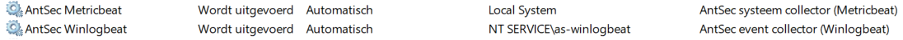
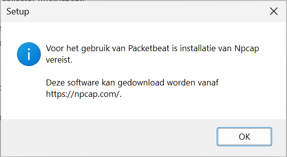
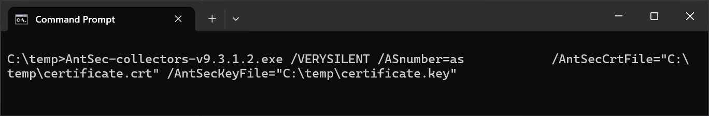
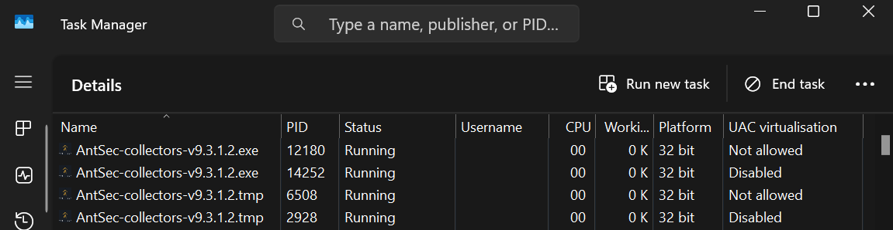

# AntSec Collector for Windows

## Thank you
Thank you for choosing the AntSec Collector.

This installer will guide you through the installation and configuration process as much as possible. If you have any questions or require assistance, please contact us through your usual support channels.

If you have reached this page and are unfamiliar with AntSec, visit our website: https://www.antsec.io

# Support

Our team is available to assist you throughout the installation process.

The default installation includes a standard configuration suitable for most environments. Depending on your requirements, additional tuning or customization may be recommended. Please contact AntSec if you would like further assistance with configuration.

## Supported platforms

### Windows Client
- Windows 10
- Windows 11

### Windows Server
- Windows Server 2016
- Windows Server 2019
- Windows Server 2022
- Windows Server 2025

### Other Supported Platforms
- Windows Server Core (2016 and newer)
- Microsoft Hyper-V Server

# Components
The AntSec Collector for Windows consists of several components that work together to collect security, operational, and performance data.

## Event Collector
Collects Windows Event Log information and securely forwards it to the AntSec platform for monitoring and analysis.

## System Collector
Collects operating system metrics, including CPU, memory, disk, and network statistics.

## File Collector
Collects log files from local applications and services. It can also receive and forward Syslog messages from external systems.

## Network Collector
Captures and analyzes network traffic metadata to provide visibility into network activity.

## Sysmon
Installs and configures Microsoft Sysmon to enhance endpoint visibility and generate detailed security telemetry.

---

# Requirements

Before starting the installation, verify that the following requirements are met:

- AntSec Collector installation package
- Local Administrator privileges
- Customer certificate and private key provided by AntSec
- 64-bit Windows operating system
- Outbound connectivity to `secops.antsec.io` on TCP port `7201`

---

# Installation

Certain server roles require additional configuration. Please review the **Custom Installations and Modifications** section before proceeding if the system is:

- A Domain Controller
- An IIS Server

## Standard installation

1. Copy the installer to the target system.
2. Launch the installer.
3. Enter the customer number provided by AntSec.
4. Click **Next**.
5. Select the certificate and private key supplied by AntSec.
6. Choose the components to install.
7. Review the installation summary.
8. Click **Install** to start the installation.

Once the installation is complete, all selected services will start automatically.



---

# Custom installations and modifications

The options described below should only be used in consultation with AntSec.

## Domain Controller installation

When installing on a Domain Controller, select the **Domain Controller Installation** option during setup.

This enables recommended collection settings for Active Directory environments.

## IIS server installation

When installing on a server running Internet Information Services (IIS), enable the **IIS Logging** option during installation.

If IIS logging was not enabled during setup, it can be activated manually:

1. Navigate to the installation directory.
2. Open the `filebeat\modules.d` folder.
3. Rename `iis.yml.disabled` to `iis.yml`.
4. Restart the AntSec File Collector service.

After the service restart, IIS logs will automatically be collected and forwarded.

---

# Silent installation

The AntSec Collector supports unattended installations using command-line parameters.

## Enable silent installation

```cmd
/VERYSILENT
```

## Specify customer Nnmber

```cmd
/ASnumber=<customer_number>
```

## Component selection

By default, the Event Collector, System Collector and File Collector are installed.

A custom component selection can be provided using:

```cmd
/COMPONENTS="winlogbeat,winlogbeat\vsawinlogbeat,winlogbeat\configwinlogbeat"
```

### Available components

#### Event collector

```text
winlogbeat
winlogbeat\vsawinlogbeat
winlogbeat\configwinlogbeat
```

#### System collector

```text
metricbeat
```

#### File collector

```text
filebeat
filebeat\vsafilebeat
filebeat\configfilebeat
filebeat\iisfilebeat
```

#### Network collector

```text
packetbeat
packetbeat\vsapacketbeat
packetbeat\configpacketbeat
```

#### Sysmon

```text
sysmon
```

## Certificate parameters

```cmd
/AntSecCrtFile="C:\Certificates\customer.crt"
/AntSecKeyFile="C:\Certificates\customer.key"
```

## Suppress messages boxes

By default, this parameter is not required. However an extra popup shows when installing components for Packetbeat during a silent installation:



Use this parameter to suppress this messagebox.

```cmd
/SUPPRESSMSGBOXES
```

## Logfile creation

To create a logfile of the setup process, add this parameter. The default location is the user's TEMP directory.

```cmd
/LOG
```

To provide a different location, use the parameter as shown below. The full filename and its path are required. If a logfile already exists, it will be overwritten.

```cmd
/LOG="C:\temp\setup.log"
```

## Example installation wizard

The installer guides the user through certificate selection, component selection and installation validation.



## Example default silent Installation

```cmd
"AntSec-Collector-v9.3.1.exe" ^
/VERYSILENT ^
/ASnumber=as12345 ^
/AntSecCrtFile="C:\Certificates\customer.crt" ^
/AntSecKeyFile="C:\Certificates\customer.key"
```

The installation remains active while the installation process is running.



---

# Responsible Disclosure

If you discover a potential security vulnerability or have security-related concerns, please contact:

**security@antsec.io**

We appreciate responsible disclosure and will work with you to investigate and resolve reported issues.